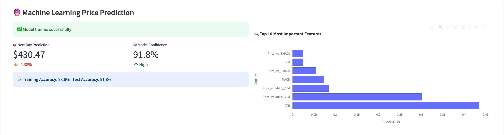
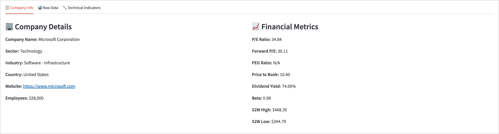

# 🚀 AI-Powered Stock Market Dashboard

[](https://www.python.org/)
[](https://streamlit.io/)
[](LICENSE)
[](https://github.com/erikthiart/ai-stock-dashboard)

> **Professional-grade stock analysis with machine learning predictions and real-time technical indicators**

A comprehensive, AI-powered stock market dashboard that combines advanced technical analysis, machine learning price predictions, and intelligent market insights in a beautiful, interactive interface.


## ⚙️ Config-driven service (`config.yaml`)

The service layer (`app.py`, served via `uvicorn app:app`) reads **all** of
ticker lists, indicator windows/thresholds, cache TTL and data-source switches
from `config.yaml`, with environment variables on top:

```
precedence:  environment variables  >  config.yaml  >  built-in defaults
```

| Config leaf | Environment variable |
|---|---|
| `tickers` | `SD_TICKERS` (comma separated) |
| `indicators.sma_windows` | `SD_INDICATORS_SMA_WINDOWS` |
| `indicators.rsi_window` | `SD_INDICATORS_RSI_WINDOW` |
| `indicators.bollinger.std` | `SD_INDICATORS_BOLLINGER_STD` |
| `cache.ttl_seconds` | `SD_CACHE_TTL_SECONDS` |
| `cache.max_entries` | `SD_CACHE_MAX_ENTRIES` |
| `sources.yfinance.enabled` | `SD_SOURCES_YFINANCE_ENABLED` |
| `sources.local_fixture.path` | `SD_SOURCES_LOCAL_FIXTURE_PATH` |
| `data.period` / `server.host` / `server.port` | `SD_DATA_PERIOD` / `SD_SERVER_HOST` / `SD_SERVER_PORT` |

Merge rules (`config_loader.py:load_config`):

- **Scalars** are replaced wholesale by the higher-precedence layer.
- **Lists** are merged item by item by index; out-of-range indices are dropped
  and recorded as diagnostics (they can't grow the list).
- **Invalid values never raise** — the leaf falls back to the lower layer and a
  diagnostic is emitted (visible on the home page and in `/config/effective`).
- An **unset** env var means "no override"; an env var explicitly set to an
  empty string **clears a list** (scalar empty values are diagnosed/ignored).
- Every other module receives one deep-frozen snapshot
  (`FrozenDict`/tuples) — it cannot mutate config.

The `ConfigStore` watches the yaml **mtime** and atomically swaps snapshots on
change; one request always reads a single consistent snapshot. Cache entries
are keyed by the snapshot fingerprint, so changing e.g.
`sma_windows: [20, ...]` to `[50, ...]` immediately changes the computed
indicators without stale entries.

Run:

```bash
uvicorn app:app                       # http://127.0.0.1:8000
# offline demo (fixture fallback, no network):
SD_SOURCES_YFINANCE_ENABLED=false uvicorn app:app
```

Endpoints:

- `/` — effective-config table (with per-key source `default|yaml|env`) and
  latest-indicators table
- `/config/effective` — full effective config, sources, fingerprint, diagnostics
- `/metrics/latest` — latest indicator row per ticker
- `/healthz` — liveness + fingerprint

If yfinance is unreachable, fetches degrade to the committed local fixture
(`tests/fixtures/sample_prices.csv`) without erroring. Tests are fully
offline:

```bash
python -m pytest -q
```

## ✨ Features

### 🤖 **Artificial Intelligence**
- **Machine Learning Price Prediction** - Random Forest model with 30+ technical features
- **AI Market Analysis** - Natural language insights based on technical indicators
- **Feature Importance Analysis** - Understand what drives price movements
- **Model Performance Metrics** - Train/test accuracy with confidence levels

### 📈 **Advanced Technical Analysis**
- **Professional Charts** - Multi-panel candlestick charts with technical overlays
- **20+ Technical Indicators** - RSI, MACD, Bollinger Bands, Moving Averages, Stochastic
- **Volume Analysis** - Volume trends and confirmation signals
- **Performance Metrics** - Sharpe ratio, volatility, maximum drawdown

### 🎯 **Real-Time Data**
- **Live Stock Data** - Real-time prices from Yahoo Finance
- **Multiple Timeframes** - 1M to 5Y analysis periods
- **Popular Stock Presets** - Quick access to FAANG+ stocks
- **Custom Symbol Input** - Analyze any publicly traded stock

### 🎨 **Professional Interface**
- **Dark Theme** - Easy on the eyes for extended analysis
- **Responsive Design** - Works perfectly on desktop and mobile
- **Interactive Charts** - Zoom, pan, and explore data
- **Organized Tabs** - Clean separation of different analysis types


## 🚀 Quick Start

### Prerequisites

```bash
Python 3.8 or higher
```

### Installation

1. **Clone the repository**
```bash
git clone https://github.com/erikthiart/ai-stock-dashboard.git
cd ai-stock-dashboard
```

2. **Install dependencies**
```bash
pip install -r requirements.txt
```

3. **Run the application**
```bash
streamlit run stock_dashboard.py
```

4. **Open your browser**
```
Navigate to http://localhost:8501
```



## 📦 Dependencies

```
streamlit>=1.28.0
yfinance>=0.2.18
pandas>=1.5.0
numpy>=1.24.0
plotly>=5.15.0
scikit-learn>=1.3.0
```

## 🎮 How to Use

### 1. **Select Your Stock**
- Choose from popular presets (Apple, Tesla, Google, etc.)
- Or enter any stock symbol manually
- Select your preferred analysis timeframe

### 2. **Explore the Analysis**
- **Main Dashboard**: Key metrics and price changes
- **Technical Charts**: Advanced multi-panel analysis
- **Performance**: Risk metrics and cumulative returns
- **AI Predictions**: Machine learning price forecasts
- **Market Analysis**: AI-generated insights

### 3. **Understand the Insights**
- 🟢 **Green indicators**: Bullish signals
- 🔴 **Red indicators**: Bearish signals  
- 🟡 **Yellow indicators**: Neutral/mixed signals
- ⚠️ **Warning indicators**: Overbought/oversold conditions


## 🧠 Machine Learning Model

Our AI uses a **Random Forest Regressor** trained on 30+ features including:

- **Price-based features**: Returns, volatility, price changes
- **Technical indicators**: RSI, MACD, moving averages
- **Volume features**: Volume ratios and trends  
- **Lag features**: Historical price and volume data
- **Statistical features**: Rolling means and standard deviations

**Model Performance:**
- Real-time training on historical data
- Cross-validation with train/test splits
- Feature importance analysis
- Confidence metrics displayed


## 📊 Technical Indicators

| Indicator | Purpose | Interpretation |
|-----------|---------|----------------|
| **RSI** | Momentum | >70 Overbought, <30 Oversold |
| **MACD** | Trend | Signal line crossovers |
| **Bollinger Bands** | Volatility | Price vs. bands position |
| **Moving Averages** | Trend | Price vs. MA relationships |
| **Stochastic** | Momentum | %K and %D oscillator |
| **Volume** | Confirmation | Volume vs. average ratios |

## 🎯 Use Cases

### 📈 **For Traders**
- Quick technical analysis of any stock
- AI-powered price predictions for next trading day
- Volume confirmation signals
- Multiple timeframe analysis

### 💼 **For Investors**
- Long-term performance metrics
- Risk assessment (volatility, drawdown)
- Company fundamental information
- Market trend analysis

### 🎓 **For Learning**
- Understanding technical indicators
- Machine learning in finance
- Market behavior patterns
- Professional chart analysis



## ⚠️ Disclaimer

**This tool is for educational and informational purposes only.**

- Not financial advice or investment recommendations
- Past performance doesn't guarantee future results
- Always do your own research before investing
- Consider consulting with financial professionals
- Markets involve risk and potential loss of capital

## 🛠️ Technical Architecture

```
├── stock_dashboard.py      # Main application
├── requirements.txt        # Dependencies
├── README.md              # Documentation
└── screenshots/           # UI screenshots
    ├── main_dashboard.jpg
    ├── technical_analysis.jpg
    ├── ml_predictions.jpg
    ├── performance_metrics.jpg
    ├── ai_analysis.jpg
    └── company_info.jpg
```

## 🤝 Contributing

Contributions are welcome! Please feel free to submit a Pull Request.

1. Fork the repository
2. Create your feature branch (`git checkout -b feature/AmazingFeature`)
3. Commit your changes (`git commit -m 'Add some AmazingFeature'`)
4. Push to the branch (`git push origin feature/AmazingFeature`)
5. Open a Pull Request

## 📝 License

This project is licensed under the MIT License - see the [LICENSE](LICENSE) file for details.

## 🌟 Acknowledgments

- **Yahoo Finance** for providing free stock data
- **Streamlit** for the amazing web framework
- **Plotly** for interactive visualizations
- **scikit-learn** for machine learning capabilities

## 📞 Support

If you find this project helpful, please give it a ⭐ on GitHub!

For questions or issues:
- Open an [Issue](https://github.com/erikthiart/ai-stock-dashboard/issues)

---

<div align="center">

**Built with ❤️ and Python**

[](https://github.com/erikthiart)
[](https://linkedin.com/in/erikthiart)

</div>
